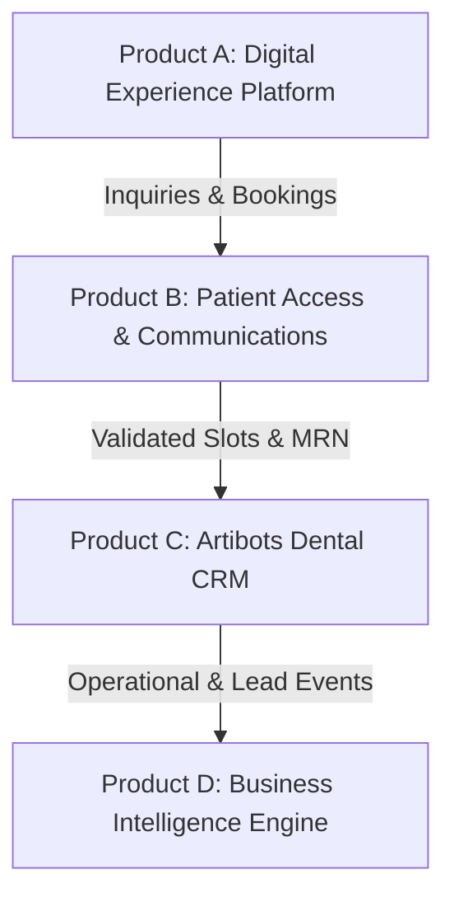

# ARTIBOTS × PREETHI’S DENTISTRY
## Document 00: Project Overview & Master Charter

**Technology Partner:** Artibots Innovation Private Limited  
**Flagship Client:** Dr. Preethi’s Dentistry, Saibaba Colony, Coimbatore, Tamil Nadu, India  
**Document Standard:** Enterprise Digital Experience, SaaS Multi-Tenancy & Clinical Governance  
**Baseline Repository:** `abtestingsites-hue/DR_Preethi_denistry` (`main` branch)  

---

### 1. Executive Summary

This platform represents the enterprise digital transformation of **Dr. Preethi’s Dentistry**, engineered by **Artibots Innovation Private Limited**. It operates as a unified, production-ready modular application that balances two strategic imperatives:

1. **Flagship Clinical Experience (Preethi's Dentistry)**: Delivering an international-standard digital brand experience, high-conversion patient intake, automated WhatsApp communications, and clear-aligner inquiry qualification.
2. **Reusable SaaS Product Foundation (Artibots Dental Core)**: Establishing a multi-tenant, compliant architecture capable of scaling across future dental and specialized healthcare practices across India.

---

### 2. The Four Connected Products

| Product | Name | Primary Objective | Key Users | Current Status |
| :--- | :--- | :--- | :--- | :--- |
| **Product A** | Premium Dental Digital Experience | Brand trust, clear-aligner education, needle-free anesthesia discovery, visitor conversion. | Prospective & existing patients | **Implemented & Verified** |
| **Product B** | Patient Access & Communications | Atomic consultation booking, collision prevention, automated WhatsApp slip dispatch. | Patients & clinic coordinators | **Implemented & Verified** |
| **Product C** | Artibots Dental CRM | Lead triage, appointment calendar, digital Rx, aligner staging, immutable audit trail. | Clinic Director, Dentists, Receptionists | **Implemented & Verified** |
| **Product D** | Business Intelligence Platform | Response-time SLA tracking, chair attendance rates, campaign attribution, queue health. | Clinic Management, Artibots Partners | **Implemented & Verified** |

---

### 3. Core Architectural Commitments

- **Zero Fake Work**: All appointment records, patient entities, communication logs, and audit trails are backed by live PostgreSQL schema models (`prisma/schema.prisma`).
- **Strict Multi-Tenant Isolation**: Every database interaction is scoped to an explicit `tenantId`. No cross-tenant data leakage is permitted.
- **Privacy & Compliance**: Architected in accordance with India's **Digital Personal Data Protection (DPDP) Act, 2023**. Zero sensitive clinical information or patient PII is sent to external advertising trackers.
- **Modular Monolith**: Built upon Next.js 14 App Router, avoiding unnecessary microservice overhead while strictly isolating domain concerns.

---

### 4. Implementation Status Classification

| Module | Classification | Evidence / Notes |
| :--- | :--- | :--- |
| Public Website Pages (`/`, `/about`, `/treatments`, etc.) | **Implemented and verified** | Live static & SSR pages with warm ivory/olive brand styling. |
| Appointment Slot Engine (`/api/appointments/availability`) | **Implemented and verified** | 10:00–13:00, 17:00–20:00 slots with collision prevention. |
| Inbound Lead Ingestion (`/api/leads`) | **Implemented and verified** | Zod schema validation, MRN auto-generation on conversion. |
| Dental CRM Back-Office (`/crm`) | **Implemented and verified** | 7 operational tabs backed by live Prisma queries. |
| Meta WhatsApp Cloud API Dispatcher | **Implemented but simulated fallback** | Real endpoint ready (`/api/cron/meta-dispatcher`); fallback simulation active until production WABA keys are loaded. |
| Enterprise Documentation Suite | **Implemented** | Canonical 18-file documentation suite under `/docs`. |
