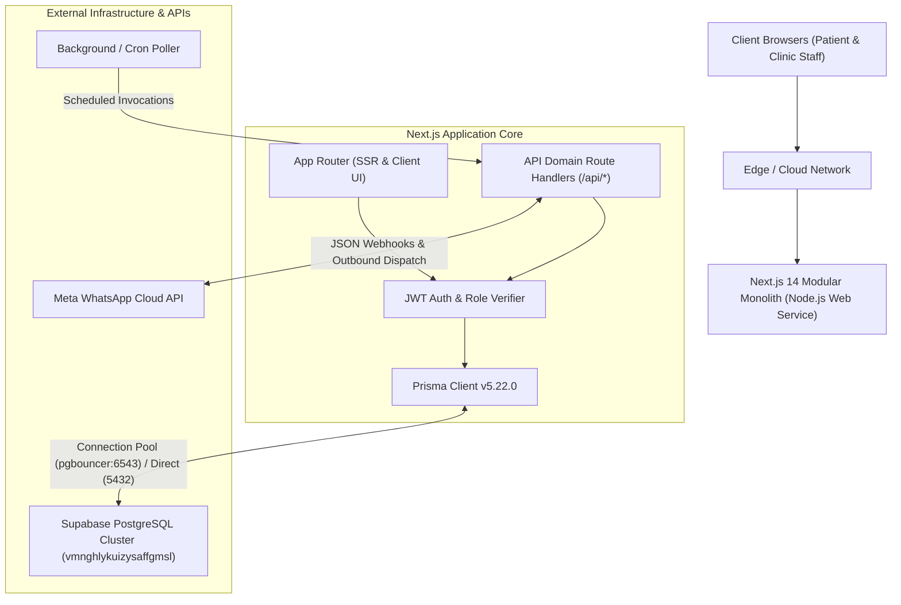

# ARTIBOTS × PREETHI’S DENTISTRY
## Document 03: System Architecture & Design Boundaries

**Technology Partner:** Artibots Innovation Private Limited  
**Architecture Style:** Enterprise Modular Monolith  
**Application Framework:** Next.js 14 (App Router) + TypeScript  

---

### 1. High-Level Architectural Diagram

---

### 2. Domain Boundaries

The application enforces strict separation of concerns across four key domains:

1. **Public Presentation Domain (`components/`, `app/(public)`)**:
   - Focuses strictly on patient education, SEO, and inquiry capture.
   - Operates with zero knowledge of CRM operational internals or database connection strings.
2. **Access & Booking Domain (`app/api/appointments`, `app/api/leads`)**:
   - Handles patient intake, input validation (Zod), and slot conflict detection.
   - Enforces atomic database updates to avoid race conditions during concurrent bookings.
3. **Practice Management Domain (`app/crm`, `app/api/crm/*`)**:
   - Enforces JWT session validation and staff role authorization (`SUPER_ADMIN`, `CLINIC_ADMIN`, `DENTIST`, `RECEPTIONIST`).
   - Contains clinical governance endpoints (prescriptions, aligner stages, audit logs).
4. **Communications & Webhook Domain (`app/api/cron/*`, `app/api/webhooks/*`)**:
   - Asynchronously processes staged communication records.
   - Verifies SHA-256 webhook signatures from Meta and updates communication delivery states.

---

### 3. Modularity & Reusability Principles

- **Tenant Scoping**: All business operations receive an explicit `tenantId`. Services do not query global sets without this filter.
- **Dependency Inversion**: Third-party communication providers (Meta Cloud API, SMS gateways) are abstracted behind normalized communication logging interfaces (`CommunicationLog`).
- **Stateless Web Services**: Authentication relies on cryptographically signed HTTP-only JWTs, enabling zero-session-state horizontal scaling.
