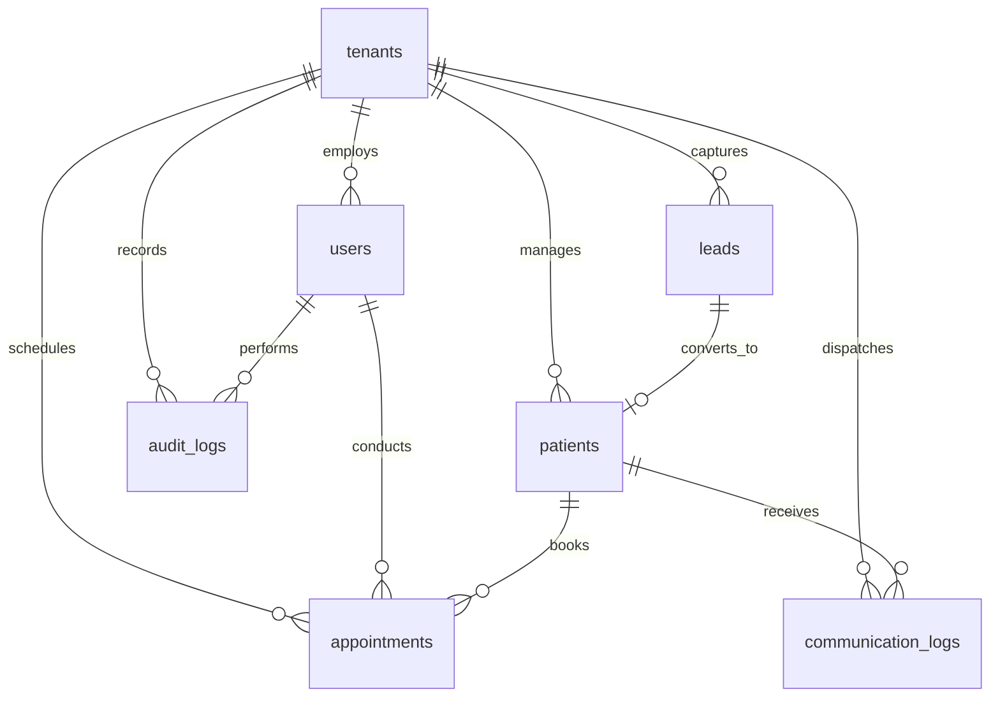

# ARTIBOTS × PREETHI’S DENTISTRY
## Document 06: Database Architecture & Data Models

**Technology Partner:** Artibots Innovation Private Limited  
**Database Cluster:** PostgreSQL 15 on Supabase (`vmnghlykuizysaffgmsl`)  
**ORM:** Prisma ORM 5.22.0  

---

### 1. Entity Relationship Diagram

---

### 2. Core Data Models Specification

#### 1. `tenants`
- **Purpose**: Represents independent dental practices or future Artibots subscribers.
- **Fields**: `id` (UUID), `slug` (Unique), `name`, `phone`, `email`, `address`, `city`, `state`, `country`, `settings` (JSONB), `createdAt`, `updatedAt`.
- **Primary Tenant**: `preethis-dentistry-cbe`.

#### 2. `users`
- **Purpose**: Staff members with access to the practice CRM.
- **Fields**: `id` (UUID), `tenantId` (FK), `email`, `passwordHash`, `fullName`, `role` (`UserRole` Enum: `SUPER_ADMIN`, `CLINIC_ADMIN`, `DENTIST`, `RECEPTIONIST`), `isActive`, `createdAt`, `updatedAt`.
- **Constraints**: Compound unique `[tenantId, email]`.

#### 3. `leads`
- **Purpose**: Prospective patient inquiries from website or WhatsApp.
- **Fields**: `id` (UUID), `tenantId` (FK), `fullName`, `phoneNumber`, `email`, `treatmentSlug`, `source` (`WEBSITE`, `WHATSAPP`, `DIRECT`, `PHONE`, `INSTAGRAM`), `status` (`NEW`, `CONTACTED`, `QUALIFIED`, `CONSULTATION_BOOKED`, `UNRESPONSIVE`, `ARCHIVED`), `assignedToUserId` (FK), `notes`, `metadata` (JSONB), `createdAt`, `updatedAt`.
- **Indexes**: `[tenantId, status]`, `[tenantId, phoneNumber]`.

#### 4. `patients`
- **Purpose**: Verified clinic patients with historical medical relationships.
- **Fields**: `id` (UUID), `tenantId` (FK), `leadId` (FK Unique), `medicalRecordNumber` (Unique string: `MRN-PD-XXXXX`), `fullName`, `phoneNumber`, `email`, `dateOfBirth`, `medicalHistory` (Text), `createdAt`, `updatedAt`.
- **Indexes**: `[tenantId, phoneNumber]`.

#### 5. `appointments`
- **Purpose**: Reserved clinical consultation or treatment slots.
- **Fields**: `id` (UUID), `tenantId` (FK), `patientId` (FK), `dentistId` (FK), `treatmentType`, `scheduledStart` (DateTime), `scheduledEnd` (DateTime), `status` (`PENDING`, `CONFIRMED`, `CANCELLED`, `RESCHEDULED`, `COMPLETED`, `NO_SHOW`), `notes`, `cancellationReason`, `createdAt`, `updatedAt`.
- **Indexes**: `[tenantId, scheduledStart]`, `[tenantId, status]`.

#### 6. `communication_logs`
- **Purpose**: Transactional message delivery queue and audit history.
- **Fields**: `id` (UUID), `tenantId` (FK), `appointmentId` (FK), `recipientPhone`, `channel` (`WHATSAPP`, `SMS`, `EMAIL`, `CALL`), `direction` (`INBOUND`, `OUTBOUND`), `templateName`, `messageBody`, `status` (`QUEUED`, `SENT`, `DELIVERED`, `READ`, `FAILED`), `metadata` (JSONB), `createdAt`.
- **Indexes**: `[tenantId, recipientPhone]`.

#### 7. `audit_logs`
- **Purpose**: Immutable activity logging for DPDP Act compliance.
- **Fields**: `id` (UUID), `tenantId` (FK), `userId` (FK), `action`, `entityType`, `entityId`, `changes` (JSONB), `ipAddress`, `createdAt`.
- **Indexes**: `[tenantId, entityType, entityId]`, `[tenantId, createdAt]`.
