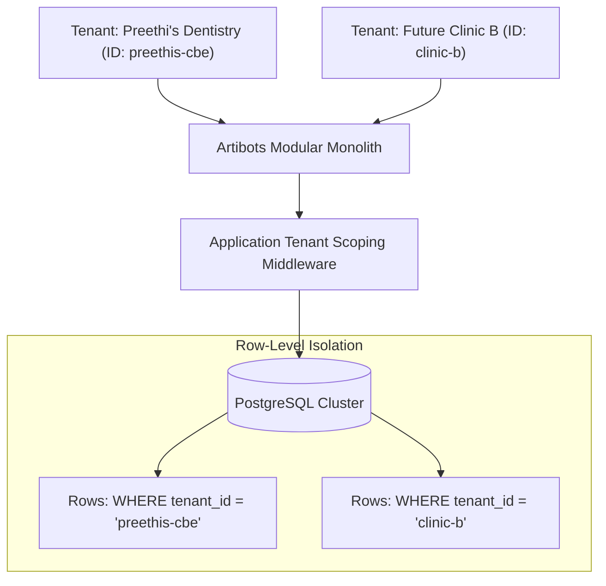

# ARTIBOTS × PREETHI’S DENTISTRY
## Document 07: Multi-Tenancy & Data Isolation Model

**Technology Partner:** Artibots Innovation Private Limited  
**Tenancy Pattern:** Pooled Database with Logical Tenant-Scoping  

---

### 1. Multi-Tenancy Strategy

To support the commercial vision of **Artibots Dental Core** as a scalable SaaS product while keeping operating costs efficient for single-clinic deployments, the architecture employs a **Shared Database, Isolated Schema Scope** approach:

---

### 2. Isolation Enforcement Rules

1. **Mandatory Foreign Key**: Every primary business entity (`users`, `leads`, `patients`, `appointments`, `communication_logs`, `audit_logs`) includes a non-nullable `tenant_id` foreign key referencing `tenants(id)`.
2. **Compound Unique Constraints**: Email addresses are unique *within a tenant*, allowing the same practitioner or patient to register across different clinics without collisions (`@@unique([tenantId, email])`).
3. **Compound Indexes**: All frequently queried columns begin with `tenantId` (e.g., `@@index([tenantId, status])`), ensuring the PostgreSQL query planner immediately isolates data per tenant before filtering by status or date.
4. **Backend-Enforced Authorization**: The API route handlers extract `tenantId` exclusively from verified JWT cookies or authenticated session contexts—never trusting arbitrary client-submitted tenant query parameters.

---

### 3. Cross-Tenant Leakage Prevention

- **Zero Global Finders**: Code is prohibited from calling `prisma.patient.findMany()` without an explicit `where: { tenantId }` predicate.
- **Tenant Context Verification**: Inbound webhooks resolve the tenant via registered phone numbers or routing headers before persisting records.
