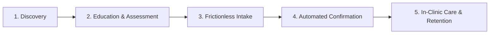

# ARTIBOTS × PREETHI’S DENTISTRY
## Document 10: Patient Journeys & Public Experience Workflows

**Technology Partner:** Artibots Innovation Private Limited  
**Flagship Client:** Dr. Preethi’s Dentistry, Coimbatore  

---

### 1. Patient Journey Overview

The digital platform is engineered to transition a casual visitor into a qualified, attended consultation through five distinct stages:

---

### 2. Stage-by-Stage Workflow Breakdown

#### Stage 1: Discovery & Credibility
- **Traffic Origin**: Local Google Search ("Best dentist in Saibaba Colony", "Invisalign Coimbatore"), Instagram reels, or direct word-of-mouth.
- **Entry Points**: Homepage (`/`), Treatment Pages (`/treatments/invisalign-clear-aligners`), or Clinical Gallery (`/gallery`).
- **Key Trust Factors**: High-resolution clinical facility imagery, verified doctor credentials (Dr. Preethi Subramanian, BDS, Fellowship in Aesthetic Dentistry), Google review ratings (4.9/5 stars), and satellite map pin location.

#### Stage 2: Education & Interactive Assessment
- **Clear Aligner Funnel**: Visitor engages with the interactive assessment widget on `/treatments/invisalign-clear-aligners`.
- **User Actions**: Selects dental alignment condition (Mild Spacing, Moderate Crowding, Overbite, Prior Braces Relapse).
- **Outcome**: Receives personalized preliminary insight with clear disclaimer: *"Only an in-clinic 3D digital scan can determine exact clinical candidacy."* Prompts immediate booking.

#### Stage 3: Frictionless Consultation Intake
- **Input Minimalization**: Only Full Name, Phone Number, and Preferred Timing are required.
- **Real-Time Verification**: The booking engine checks `/api/appointments/availability` to ensure no conflicting chair appointments exist.
- **Atomic Reservation**: Slot is temporarily reserved upon submission to prevent race conditions.

#### Stage 4: Automated Communication & Slip Dispatch
- **Patient Slip Delivery**: An automated WhatsApp message is queued immediately:
  - Appointment Date & Time
  - Clinic Location (Google Maps Direct Link)
  - Pre-visit instructions (arrive 10 mins early)
- **Status Visibility**: Staff immediately sees the new appointment in the CRM calendar.

#### Stage 5: In-Clinic Care & Post-Op Follow-Up
- **Attendance**: Front desk marks status `COMPLETED`.
- **Digital Follow-Up**: Automated WhatsApp post-op care guidance dispatched based on treatment type (e.g., Aligner Tray wear guidelines, extraction care).
