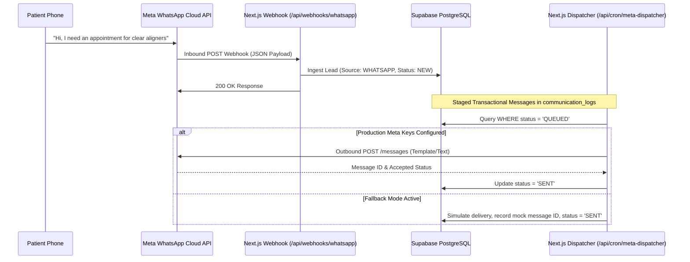

# ARTIBOTS × PREETHI’S DENTISTRY
## Document 12: WhatsApp Business Cloud API & Messaging Integration

**Technology Partner:** Artibots Innovation Private Limited  
**Messaging Gateway:** Meta WhatsApp Cloud API (Graph API v19.0+)  

---

### 1. Integration Architecture



---

### 2. Required Meta Configuration Variables

The following environment variables govern live Meta WhatsApp Cloud API communications:

```bash
# Meta Cloud API Configuration
WHATSAPP_PHONE_NUMBER_ID=""        # Meta Business Phone Number ID
WHATSAPP_BUSINESS_ACCOUNT_ID=""    # Meta WABA ID
WHATSAPP_ACCESS_TOKEN=""           # Permanent System User Access Token
WHATSAPP_VERIFY_TOKEN=""           # Custom webhook verification secret
WHATSAPP_API_VERSION="v19.0"       # Meta Graph API version
```

---

### 3. Approved Transactional Message Templates

1. **`appointment_confirmation_v1`**:
   - *Body*: "Hello {{1}}, your consultation at Dr. Preethi's Dentistry is confirmed for {{2}} at {{3}}. Location: https://maps.app.goo.gl/SaibabaColony. Please arrive 10 minutes prior."
2. **`appointment_rescheduled_v1`**:
   - *Body*: "Hello {{1}}, your appointment has been updated to {{2}} at {{3}}. For queries, reply to this message."
3. **`aligner_wear_checkin_v1`**:
   - *Body*: "Hi {{1}}, this is Dr. Preethi's team checking in on Tray {{2}}. Please ensure you wear aligners for 22 hours daily."

---

### 4. Zero-Failure Simulation Fallback

When operating in staging, testing, or before live Meta WhatsApp Business approval:
- The system automatically detects missing or invalid Meta credentials.
- Rather than throwing fatal runtime exceptions, `/api/cron/meta-dispatcher` logs the message payload, generates a traceable simulated message ID (`SIM-WA-XXXXX`), and transitions the record to `SENT`.
- Front-desk staff can inspect message contents in the CRM communication log without disruption.
